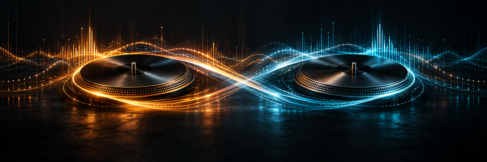
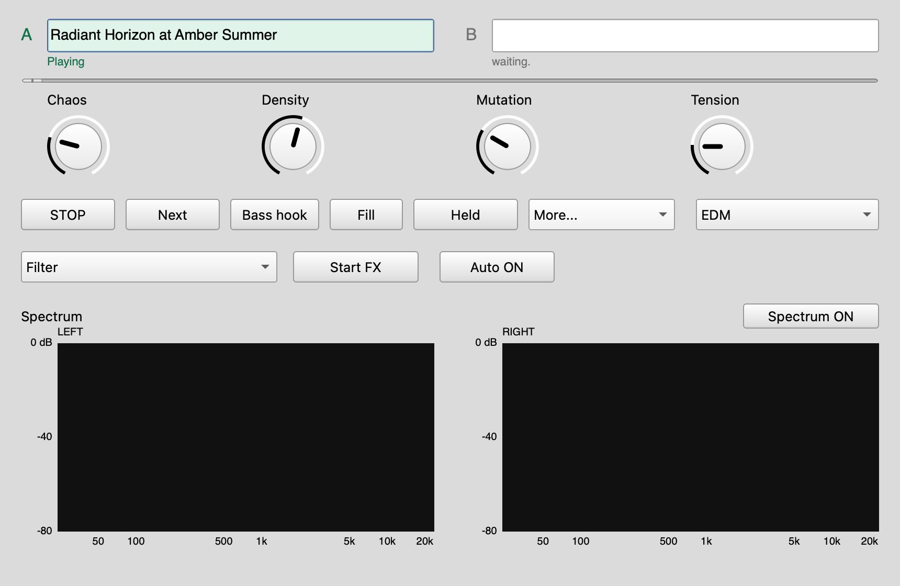

# Infinite DJ

> **[Play Infinite DJ in your browser](https://jorisesch.github.io/supercollider/)**
>
> Choose EDM, Pop, Soundscape or Rock. The music is generated live on your device.



An endless set that creates and mixes new tracks as it goes. Let it play, or shape the music with a few controls.

## Listen

Try the [live browser player](https://jorisesch.github.io/supercollider/) or open a recording below.

- **[EDM](audio/edm-e-set.m4a)** — bass, drums and warm synth grooves.
- **[Pop](audio/dj-pop-preview.m4a)** — bright synths and returning hooks.
- **[Rock](audio/rock-blues.m4a)** — humbucker riffs, blues grooves, bass and a room drum kit.
- **[Soundscapes](audio/infinite-soundscape.m4a)** — slow, evolving textures.

These previews are recordings; the generator itself keeps playing. The [companion page guide](site/README.md) explains how the website is built and published.

## Run it

1. Install **[SuperCollider](https://supercollider.github.io/downloads)**. It is free.
2. On this repository's GitHub page, choose **Code → Download ZIP**, then unzip it.
3. Open **Terminal**, type `cd ` (with a space), drag the unzipped folder into Terminal, and press Return.

On macOS, paste this command and press Return:

```sh
/Applications/SuperCollider.app/Contents/MacOS/sclang -D infinite/infinite-edm.scd
```

You can also run `./bin/mobius.sh` from the repository folder. Add `pop`, `soundscape` or `rock` to start in that channel.

The control window opens and music starts. No sample packs, SuperDirt setup or manual server start are needed.

For Windows/Linux instructions, other channels and help starting, follow the **[Infinite DJ run guide](infinite/experiments/dj/README.md)**.

## Make it your own

Move **Chaos**, **Density**, **Mutation** or **Tension** to change the music. Try **Fill**, request the **Next** track, or choose **EDM**, **Pop** or **Rock** in the channel menu. Changes may take a few seconds to enter with the music.

Each launch starts a freshly seeded set. **Auto / varied songs** changes scales between songs, with rarer modes available at higher **Tension**. Choose a named mode to keep one scale, then press **Apply mode**. The **👍 / 👎** buttons under each deck save your ratings for later training.

To use an effect, select it and press **Start FX**. Press **Stop FX** to release it.

**Close the window to fade out and exit.** The STOP / START button pauses and continues the set; Ctrl+C in its Terminal stops it immediately.



For **infinitely evolving soundscapes**, use the [separate Soundscape launcher](infinite/experiments/dj/README.md#soundscapes).

## More to explore

- [Composed tracks](infinite/studies/README.md)
- [Sound effects and patches](patches/README.md), including Quindar tones, rocket launch and sonar
- [Neon Rush](neon-rush/README.md), a short dance track
- [SuperCollider music skill](skill/supercollider-music/SKILL.md), for creating more music and sounds

Technical details and rendering commands live in the [development notes](infinite/experiments/dj/TECHNICAL.md). Custom startup behavior is explained in the [startup guide](docs/startup.md).
