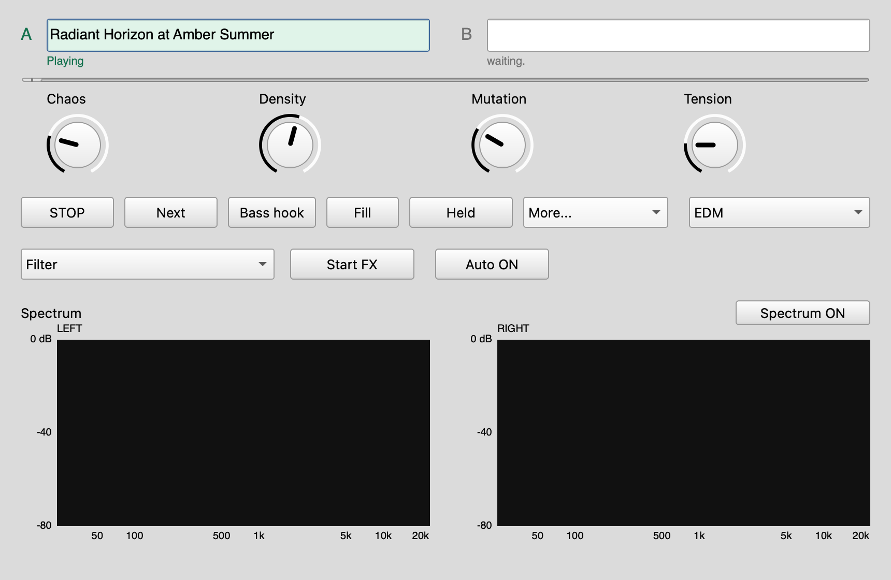

# Infinite DJ

**[Companion listening page & setup](site/README.md)** — embedded listening demos, the live controls and a quick technical introduction.

An ongoing DJ set generated with **[SuperCollider](https://supercollider.github.io/)**, free, open-source audio software for macOS, Windows and Linux.

Infinite DJ is a music generator that can keep playing indefinitely. It creates and mixes successive records as it goes, changing instruments, keys and arrangements across the set.

The current direction is house and electro driven by bass and drums: recognizable grooves, small rhythmic variations and sparse melodic phrases. Four instrument ensembles give successive records different characters.

A compact control window lets you steer the music, hold a record, request fills and start or stop an effect from one menu. Playing indicators and an A/B mix slider show which deck you hear. Hover over a track name for its details, or use the name to replay it from your local recipe library. A stereo spectrum analyzer shows the final mix.

*Live EDM playback: the leading deck is highlighted and both spectrum panels show the actual stereo mix.*

**[Listen to the current set](audio/dj-groove-v6d.m4a)** · **[Hear the favorite groove](audio/groove-track-v6c.m4a)** · **[Launch Infinite DJ](infinite/experiments/dj/README.md)**

### Pop channel

Infinite DJ also plays **instrumental Pop**: bright synth hooks, offbeat bass, verses, returning choruses and automatic handovers. Start it with `sclang -D infinite/experiments/pop.scd`, or choose **Pop** in the DJ window. The current EDM channel is preserved; Soundscape keeps its existing launcher.

**[Listen to Pop](audio/dj-pop-preview.m4a)** · **[Pop channel guide](infinite/experiments/dj/README.md#pop-channel)**

## Other experiments

- **[Infinite music and soundscapes](infinite/README.md):** the original four-track generator, with controls for how its patterns evolve.
- **[Composed tracks](infinite/studies/README.md):** shorter arrangements exploring house, electro, garage, disco and funk.
- **[Neon Rush](neon-rush/README.md):** a short trance / Eurodance sketch with editable synths and an offline render.
- **[Sound design](docs/sound-design.md):** Quindar radio tones, vinyl crackle, a rocket launch and an experimental pod-racer engine. There is also a **[submarine sonar patch](audio/sonar-ping.scd)**.

## Try it

Install SuperCollider, then follow the [Infinite DJ guide](infinite/experiments/dj/README.md) to start the music and open its controls.

For individual sound effects, open a standalone `.scd` patch from [`audio/`](audio/) in SuperCollider, select the entire file and evaluate it. Each includes its instruments and playback sequence.

Compact listening previews are included in the repository. Large WAV exports are generated locally and excluded from Git.

### Does launching sclang start the audio server?

Normally, `sclang` starts the language interpreter; `scsynth` is the separate audio server. Code such as `s.boot` or `s.waitForBoot` starts the server. Infinite DJ boots its own server automatically, so no manual boot is needed.

SuperCollider also evaluates your user `startup.scd` whenever the language starts, including command-line renders. A startup file that boots the server and starts SuperDirt therefore makes those services start automatically. This is a local configuration choice, not a requirement of Infinite DJ. Running multiple language sessions with that setup can cause OSC port conflicts.

The optional [startup.scd example](patches/startup.scd) in this repo configures a stereo, output-only default server and starts SuperDirt on OSC port 57120. It requires SuperDirt and its samples. Personal sample folders and custom patch loads are omitted. **The repository copy does not run automatically**, and Infinite DJ does not need it.

To find your active startup file, evaluate `Platform.userConfigDir +/+ "startup.scd"` in SuperCollider, or choose **File → Open startup file**. On macOS it is normally `~/Library/Application Support/SuperCollider/startup.scd`. Back up any existing file before copying or merging the example into that location. Leave it uninstalled for a DJ-only setup, or comment out the SuperDirt boot block in your active file if you want to start SuperDirt manually. Editing the repository example does not change your installed startup file.

## Repository layout

- [infinite/](infinite/README.md): Infinite DJ, generators and composed listening studies.
- [patches/](patches/README.md): sound-design sources, live controls, batch renderers and the optional startup example.
- [audio/](audio/): compact listening previews and self-contained playback patches.
- [neon-rush/](neon-rush/README.md): the standalone trance / Eurodance sketch.
- [scripts/](scripts/README.md): audio verification and site packaging tools.
- [site/](site/README.md): the companion listening page and GitHub Pages setup.
- [docs/](docs/sound-design.md): sound-design notes, research and README images.
- [skill/](skill/supercollider-music/SKILL.md): the reusable composition skill.

Repository contributor and agent instructions are in [.agents/AGENTS.md](.agents/AGENTS.md).

## Build more

The **[SuperCollider music skill](skill/supercollider-music/SKILL.md)** gives a coding agent a working approach to composition and sound design: build editable instruments, arrange them, render audio and check the result. It can also serve as a guide for making your own patches.
